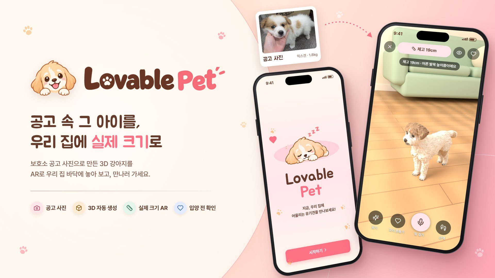
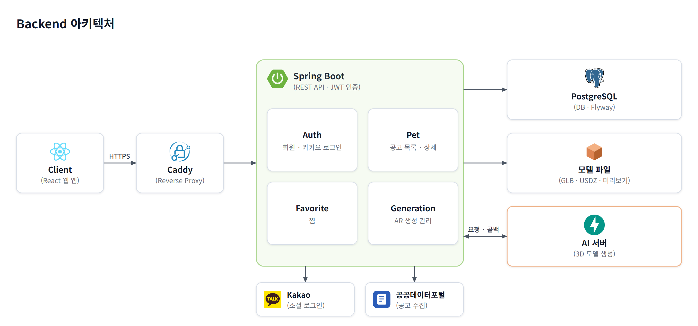
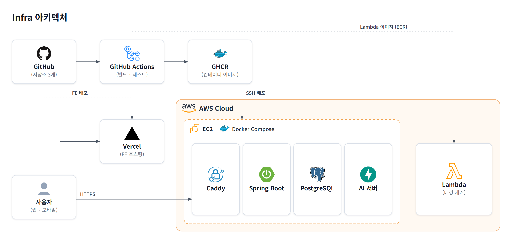

<div align="center">



<br>

**보호소 강아지를 입양 전에 우리 집에 띄워, 실제 크기로 함께 지내는 모습을 미리 체험해 보는 AR 서비스**

Lovable Pet의 **Spring Boot 백엔드** 저장소입니다.

<br>


</div>

<br>

## 🐾 하는 일

- 공공데이터포털의 구조동물 공고를 매주 월요일 동기화해, 입양할 수 있는 유기견의 목록 · 상세 · 필터 API로 제공합니다.
- 관리자가 고른 유기견의 AR 모델 생성을 AI 서버에 요청하고, 완료 콜백으로 받은 GLB · USDZ와 미리보기 그림을 저장해 제공합니다.
- 아이디 · 카카오 로그인(JWT)과 찜 기능을 제공합니다.

<br>

## 🏗️ 아키텍처



<br>

## 📡 주요 API

요청 · 응답 필드와 실패 코드는 Swagger UI에 정리되어 있습니다.

| 구분 | 메서드 | 경로 | 설명 | 권한 |
| :-- | :-- | :-- | :-- | :-- |
| 인증 | `POST` | `/api/auth/signup` | 회원가입 | 누구나 |
| | `POST` | `/api/auth/login` | 아이디 로그인 | 누구나 |
| | `GET` | `/api/auth/check-username` | 아이디 중복 확인 | 누구나 |
| | `POST` | `/api/auth/kakao` | 카카오 로그인 | 누구나 |
| | `POST` | `/api/auth/reissue` | 토큰 재발급 | 누구나 |
| | `POST` | `/api/auth/logout` | 로그아웃 | 누구나 |
| 유기견 | `GET` | `/api/pets` | 목록 (지역 · 품종 · 체중 · AR 유무 · 정렬) | 누구나 |
| | `GET` | `/api/pets/filters` | 목록 필터 선택지 | 누구나 |
| | `GET` | `/api/pets/{id}` | 상세 (AR 모델 포함) | 누구나 |
| 찜 | `GET` | `/api/members/me/favorites` | 내 찜 목록 | 로그인 |
| | `PUT` | `/api/members/me/favorites/{petId}` | 찜하기 | 로그인 |
| | `DELETE` | `/api/members/me/favorites/{petId}` | 찜 취소 | 로그인 |
| AR 모델 | `GET` | `/models/{desertionNo}/{fileName}` | GLB · USDZ · 미리보기 그림 파일 | 누구나 |
| 관리자 | `POST` | `/api/admin/pets/sync` | 공공데이터 동기화 바로 실행 | ADMIN |
| | `POST` | `/api/admin/pets/{id}/model/fit` | 고른 사진으로 만들 수 있는지 확인 | ADMIN |
| | `POST` | `/api/admin/pets/{id}/model` | AR 만들기 | ADMIN |
| | `GET` | `/api/admin/pets/{id}/model` | 최근 AR 생성 상태 | ADMIN |
| | `GET` | `/api/admin/pet-models` | AR 생성 시도 목록 | ADMIN |
| | `POST` | `/api/admin/pet-models/previews` | 미리보기 그림 일괄 생성 | ADMIN |
| 내부 | `POST` | `/internal/pet-models/callback` | AI 서버의 생성 완료 콜백 | API 키 |

<br>

## 📁 패키지 구조 (도메인형)

```
com.lovablepet
├── domain/             # 비즈니스 도메인
│   ├── auth/           # 아이디 · 카카오 로그인, 토큰 발급 · 재발급
│   ├── member/         # 회원, 역할 (USER / ADMIN)
│   ├── pet/            # 유기견, 공공데이터 동기화, 목록 · 상세 · 필터
│   ├── favorite/       # 찜
│   └── generation/     # AR 생성 요청 · 콜백, GLB · USDZ · 미리보기 그림 제공
└── global/             # 전역 설정 / 공통 모듈
    ├── config/         # Security, CORS, OpenAPI, RestClient, 스케줄링 설정
    ├── security/       # JWT 필터, 인증 · 권한 오류 응답
    ├── exception/      # ErrorCode, BusinessException, GlobalExceptionHandler
    └── response/       # 공통 응답 포맷 (ApiResponse, ErrorResponse)
```

새 도메인은 `domain/{도메인명}/` 아래에 `controller / service / repository / entity / dto` 구조로 추가합니다.

<br>

## 📦 공통 응답 포맷

모든 API는 아래 형식으로 응답합니다. 값이 없는 필드도 `null`로 항상 포함합니다.

```jsonc
// 성공
{
  "resultType": "SUCCESS",
  "success": { "data": { ... } },   // 반환할 데이터가 없으면 { "data": null }
  "error": null,
  "meta": { "timestamp": "2026-06-30T22:10:00", "path": "/api/auth/login" }
}

// 실패
{
  "resultType": "FAIL",
  "success": null,
  "error": {
    "code": "COMMON_400",
    "message": "잘못된 입력값입니다.",
    // 입력값 검증 실패일 때만 항목별 오류 목록, 그 외에는 null
    "details": [ { "field": "name", "rejectedValue": "", "reason": "공백일 수 없습니다" } ]
  },
  "meta": { "timestamp": "2026-06-30T22:10:00", "path": "/api/pets" }
}
```

- `meta.timestamp`는 항상 한국 시간(KST), `meta.path`는 요청 경로(쿼리스트링 제외)입니다.
- 컨트롤러는 `ApiResponse.ok(data)`만 반환하면 됩니다. `meta`는 `ApiResponseMetaAdvice`가 자동으로 채웁니다.

도메인 예외는 `BusinessException`을 상속하고, 에러 코드는 `ErrorCode` enum에 추가합니다.

<br>

## 🌿 브랜치 전략

```
feat/*, fix/*, refactor/*, docs/*, chore/*  ──PR──▶  dev  ──PR──▶  main
                                                     (개발 통합)     (배포)
hotfix/*  ──PR──▶  main (긴급 수정, dev에도 반영)
```

| 브랜치 | 역할 | 규칙 |
|---|---|---|
| `main` | 배포용 | 직접 push 금지. **`dev` 또는 `hotfix/*`에서 오는 PR만** 머지 |
| `dev` | 개발 통합 (기본 브랜치) | 작업 브랜치 PR이 머지되는 곳 |
| `feat/*` | 기능 개발 | `dev`에서 분기 → 작업 → `dev`로 PR |
| `fix/*` | 버그 수정 | `dev`에서 분기 → 수정 → `dev`로 PR |
| `refactor/*` | 동작 변경 없는 코드 개선 | `dev`에서 분기 → 작업 → `dev`로 PR |
| `docs/*` | 문서 수정 (README 등) | `dev`에서 분기 → 작업 → `dev`로 PR |
| `chore/*` | 빌드·설정·의존성·CI 변경 | `dev`에서 분기 → 작업 → `dev`로 PR |
| `hotfix/*` | 배포 중 긴급 버그 수정 | **`main`에서 분기** → `main`으로 PR → 머지 후 `dev`에도 반영 |

브랜치 이름 예시: `feat/pet-upload`, `fix/match-rerank`, `refactor/pet-service`, `docs/readme-api`, `chore/gradle-update`, `hotfix/login-500`

커밋 메시지 권장 형식: `type(scope): 설명`
(`feat`, `fix`, `refactor`, `docs`, `test`, `chore`, `ci` 등)

<br>

## 🚀 배포



- `dev` · `main`으로의 PR과 push마다 CI(빌드 · 테스트)와 CD(이미지 빌드, 운영 설정으로 뜨는지 확인)가 돕니다.
- `main`에 머지되면 이미지를 GHCR에 올리고, EC2에서 새 이미지로 교체합니다.
- 서버는 AWS EC2에서 Docker Compose로 운영하고, HTTPS는 Caddy가 맡습니다.

<br>

## 👥 BE 담당

| 팀원 | 맡은 일 |
| :-- | :-- |
| [**이주영**](https://github.com/LeeJuYoung12)<br><sub>LeeJuYoung12</sub> | 프로젝트 초기 세팅, 공공데이터 동기화와 유기견 조회 API, AR 생성 관리 (AI 서버 연동, GLB · USDZ 제공), 관리자 권한, 배포 (EC2 · Caddy · GitHub Actions) |
| [**김태우**](https://github.com/taetu)<br><sub>taetu</sub> | 회원 · 인증 (아이디 · 카카오 로그인, JWT), 공통 응답 · 예외 처리, 찜 API |
| [**안재인**](https://github.com/anjaein)<br><sub>anjaein</sub> | AR 미리보기 그림 (`previewUrl`) |
